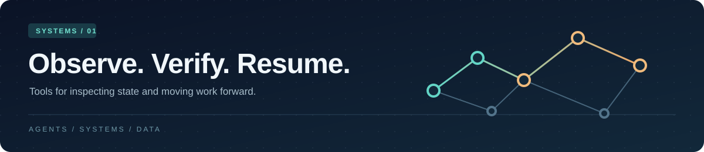

  

<strong>Small tools for clearer decisions.</strong> Agent memory · Developer tooling · Applied data systems

---

### What I build

I work on tools that make complex systems easier to inspect, test, and trust. The projects here range from graph based agent memory and lightweight command line utilities to a small x86 virtual machine and data analysis services.

### Selected work

| Project | What it explores |
| :--- | :--- |
| [traceGraph](https://github.com/amirtqa9/traceGraph) | Graph memory for agent workflows, with explicit state and validation. |
| [capsule-lint](https://github.com/amirtqa9/capsule-lint) | Checks structured handoff notes for missing or inconsistent information. |
| [rediscovery-tax](https://github.com/amirtqa9/rediscovery-tax) | Estimates the cost of rebuilding context after work is interrupted. |
| [vm-x86](https://github.com/amirtqa9/vm-x86) | A C based x86 emulator built around a documented instruction subset. |
| [PythonFraudinv](https://github.com/amirtqa9/PythonFraudinv) | A FastAPI fraud scoring service using transaction graph signals. |
| [DAagentic](https://github.com/amirtqa9/DAagentic) | A data pipeline for cleaning, statistical analysis, prediction, and synthesis. |

### Working style

Keep the interface simple. Make assumptions visible. Test the path that matters. Leave a project easy to run and easy to understand.

Public repositories here are experiments and independent projects. Setup instructions and project scope live in each repository.
